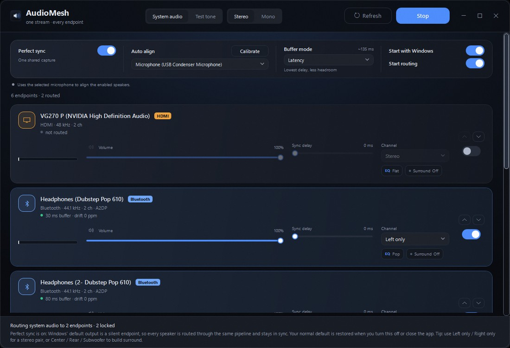
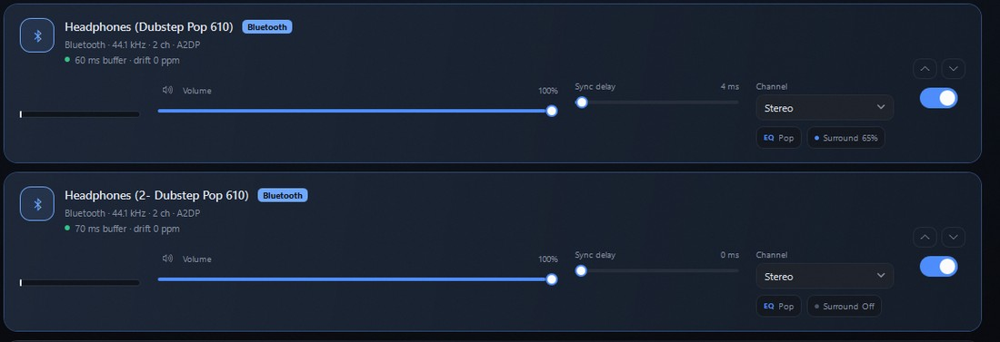
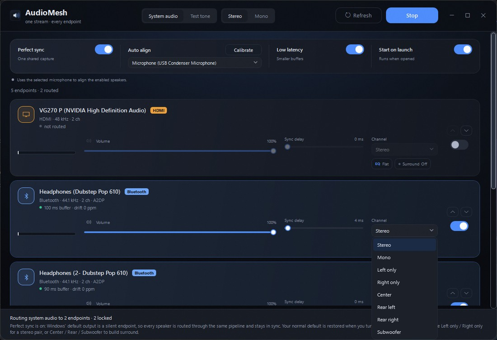
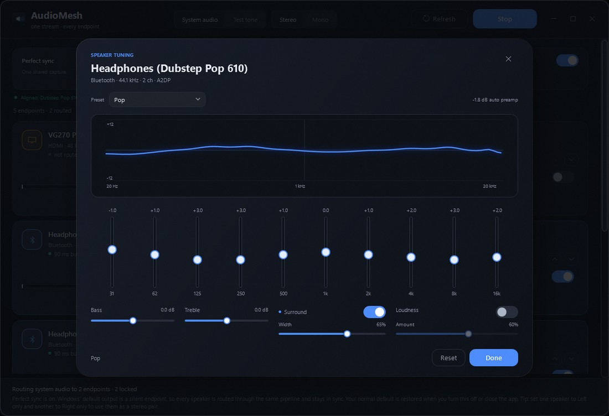

# AudioMesh

[](https://buymeacoffee.com/issac_john)

Route one audio stream to **every** playback endpoint on a Windows machine at the same time —
internal speakers, USB DAC, HDMI/DisplayPort monitor and Bluetooth headsets — with per-device
volume, per-device alignment delay, and automatic clock-drift correction.

Built from scratch: WPF UI on top of a WASAPI fan-out engine (NAudio) with a custom
band-limited sinc resampler and a closed-loop drift controller.

```
        system audio (WASAPI loopback)  ──┐
        or built-in test tone          ──┤
                                          ▼
                                   shared ring buffers
                                   ┌──────┼──────┬──────┐
                                   ▼      ▼      ▼      ▼
                                ASRC   ASRC   ASRC   ASRC     per-device ratio (±ppm)
                                   │      │      │      │
                                delay  delay  delay  delay    per-device sync offset
                                   │      │      │      │
                               WASAPI WASAPI WASAPI WASAPI
                              speakers  USB    HDMI   Bluetooth
```

## Screenshots

**Main window** — Perfect sync, Auto align, buffer mode, and one card per endpoint.



**Per-speaker controls** — volume, sync delay, channel role, EQ preset and surround toggle.



| Channel modes | Per-speaker EQ |
|:---:|:---:|
|  |  |

## Why the resampler matters

Every output device runs on its own crystal. Two devices that both report "48 kHz" are
typically 20–200 ppm apart, which is ~1 ms of drift every 5–50 seconds. Play long enough and
one device's buffer either overflows or starves — that is the stutter you hear with every
naive "duplicate the stream" tool.

AudioMesh keeps a small elastic buffer per device (80 ms wired, 150 ms Bluetooth) and
continuously nudges the resampling ratio so the buffer stays at exactly that level. The
correction is in the tens of ppm, i.e. inaudible, and it is applied per device, so a cheap
Bluetooth dongle and a studio DAC can run side by side.

The second half of the problem is **latency**, not drift: Bluetooth sits 150–300 ms behind a
wired DAC. The **Sync delay** slider per device delays the fast outputs until they line up.
The delay is applied by moving the read pointer one frame at a time, which is a 1/48000 rate
change — no clicks, no gaps.

## Features

- Enumerates every active render endpoint, hot-plug aware (rescans every 3 s)
- A device that appears later (reconnected speaker, plugged-in DAC) is moved to the top of the list
- Independent enable / volume / mute / delay per device
- Reorder speaker cards with the ↑ / ↓ buttons; the order is saved between runs
- Global **Stereo / Mono** output, plus a per-device channel mode
  (**Stereo**, **Mono**, **Left only**, **Right only**, **Center**, **Rear left**,
  **Rear right**, **Subwoofer**) — so separate speakers can act as a stereo pair or a
  matrix-decoded surround layout
- **Virtual surround** per speaker: a width control that widens the side image and adds a
  short reflection while keeping bass centred, so even one or two speakers sound bigger
- **Buffer mode** — **Latency**, **Balanced** or **Stable** moves the capture, elastic and
  render buffers together. Latency is closest to direct playback (~135 ms app-side for
  Bluetooth), Stable keeps the most headroom (~310 ms)
- **Auto sync**: plays a short tone on each enabled speaker, records it with a selectable
  microphone, and sets the relative delays automatically
- **Estimate delays**: sets the same delays from endpoint class (Bluetooth, HDMI, USB,
  analog) plus the buffer mode, with no microphone; trim by ear with the test tone
- **Auto-heal**: re-estimates those delays when a device reconnects or its format changes,
  and a watchdog reopens any endpoint that stops rendering without reporting an error
- **Update check**: looks at the GitHub release feed on launch and every six hours; About
  and the tray menu have a manual *Check for updates*, with release notes and a one-click
  installer download
- **Per-speaker EQ**: 10 graphic bands, bass/treble shelves, volume-aware loudness, presets
  and a live response curve
- **Start with Windows** and **Start routing** toggles, plus a **Refresh** button that re-reads
  both speakers and microphones (with a spinning indicator)
- Closing or minimizing keeps AudioMesh in the notification area; **Exit** in the tray menu
  quits it, and launching it again brings the running window forward
- Remembers the window position/size and launches a single instance
- Warning banner when three or more Bluetooth speakers are enabled, because a single Bluetooth
  radio rarely carries three A2DP streams reliably
- Custom dark window chrome (no system title bar), dark scroll bars with light outlines, and a
  speaker app icon
- Source: system audio (loopback capture of the default device) or a built-in test tone
  (1 kHz reference + click every 2 s, for aligning delays by ear)
- Live per-device telemetry: buffer level, drift in ppm, dropout count, peak meter
- Handles any endpoint mix format: float32, 16/24/32-bit PCM, 2–8 channels
- Settings persist per endpoint ID in `%APPDATA%\AudioMesh\settings.json`

## Requirements

- Windows 10/11 x64
- .NET 8 SDK (or runtime, for the prebuilt binary)

## Build & run

```powershell
# from the repository root
.\build.ps1
.\run.ps1
```

Or directly:

```powershell
dotnet build .\src\AudioMesh\AudioMesh.csproj -c Release
.\src\AudioMesh\bin\Release\net8.0-windows\AudioMesh.exe
```

`build.ps1` / `run.ps1` fall back to a user-local SDK at
`%LOCALAPPDATA%\dotnet-sdk\dotnet.exe` if `dotnet` is not on `PATH`.

## Usage

1. Plug in the devices you want to use and press **Refresh** (it re-reads speakers and
   microphones).
2. Turn on **Perfect sync** if you want several speakers to be in sync with each other (see below).
3. Flip the switch on each endpoint you want to route to.
4. Run **Auto sync** if you want the delays measured: pick the microphone, put it where you
   listen, and press **Calibrate**. It plays a tone on each speaker in turn and writes the
   relative delays automatically.
5. Or set **Sync delay** manually when mixing technologies: wired/USB/HDMI ≈ 0 ms, Bluetooth
   ≈ 150–250 ms behind a wired device (tune by ear with the test tone — the click should land at
   the same instant on every device).
6. Press **Start routing**, or enable **Start routing** in the setup deck so it happens
   automatically. Turn on **Start with Windows** to launch at sign-in; closing or minimizing
   keeps AudioMesh in the notification area until you choose **Exit** from its menu.
7. Play something in any application.

For video, choose **Latency** in **Buffer mode**; it removes roughly 200 ms of buffering
compared with Stable. Bluetooth link latency still remains, so also use the player's A/V
sync/audio-delay control if lips are still off (browsers generally have no such control).
If the Bluetooth link starts dropping with Latency, move to **Balanced** or **Stable**.

### Mono, stereo, and stereo pairs

The header has a global **Stereo / Mono** switch:

- **Stereo** passes the original left and right channels through.
- **Mono** downmixes to `(L + R) / 2` *before* fan-out, so every speaker hears exactly the same
  signal. Good for a room of ceiling speakers or for filling a space where stereo imaging does
  not matter.

The **Channel** picker on each card decides what that endpoint does with the stream:

| Mode | What the speaker plays |
|---|---|
| Stereo | Left channel on the left driver, right on the right |
| Mono | The L+R downmix on both drivers |
| Left only | The left channel on both drivers (front left) |
| Right only | The right channel on both drivers (front right) |
| Center | The phantom centre (L+R sum) — use for a dedicated centre speaker |
| Rear left | The left side difference (L-R), high-passed, for an ambient rear speaker |
| Rear right | The right side difference (R-L), high-passed, for an ambient rear speaker |
| Subwoofer | Mono below the 90 Hz crossover — use for a sub or bass shaker |

**To use two separate speakers as one stereo pair**, set one card to **Left only** and the other
to **Right only**, keep the global switch on **Stereo**, and route both. The two speakers now
reproduce the left and right halves of the mix instead of each playing the full stereo image.

### Surround from a stereo source

Stereo already contains the information a surround decoder needs: the sum is the front/centre
image, the difference is the side/rear ambience, and the bass is in the sum. Assign roles with the
**Channel** picker:

- front pair: **Left only** / **Right only**
- **Center** for a centre speaker
- **Rear left** / **Rear right** for the ambient speakers (bass removed so it does not cancel
  with the front pair)
- **Subwoofer** for a sub or bass shaker

Use **Auto sync** or **Sync delay** afterwards so the rear speakers line up with the front pair.
Surround roles need the global **Stereo** switch; turning on **Mono** makes rear roles fall back
to the full mono mix instead of going silent.

The **Surround** chip on each card turns on the virtual width effect for that speaker, and the
**Width** slider in the tuning panel sets how wide it goes. It works on speakers set to
**Stereo**: the side image is widened, bass stays centred, and a short reflection adds
spaciousness without delaying the direct sound.

Auto sync probes with a high-frequency tone, so a speaker set to **Subwoofer** may not be
heard by the microphone. Leave a subwoofer's delay at 0 or set it by ear.

If a pair drifts apart, use **Sync delay** on the faster speaker, exactly as with any other pair
of endpoints. With Bluetooth speakers, enable **Perfect sync** so both go through the same
pipeline.

### Three or more Bluetooth speakers

One Bluetooth radio realistically carries one or two A2DP streams. Windows can show three
speakers as active and keep rendering to all of them while one stops receiving audio — the app's
meters look healthy, but the radio is congested. AudioMesh shows a warning when three or more
Bluetooth endpoints are enabled.

Fixes, best first:

- put the speakers in **TWS / party mode** so the pair shares one link,
- connect one speaker **by wire**,
- run **two at a time** when sync matters,
- add a **second Bluetooth adapter** and spread the links across the radios.

### Why the default device cannot be routed

Loopback capture records what the **default** device is playing. That device already plays the
original stream natively, so the app never renders to it: doing so would feed our own output
back into the capture, and you would hear the same second of audio repeating forever.

AudioMesh enforces this. The default card shows
`capture source — plays natively, not re-routed` and its switch is disabled while the source is
**System audio**. It becomes routable again when you switch to **Test tone** (no capture, no
feedback path) or when a different endpoint becomes the default.

### Perfect sync (recommended)

The default device plays natively, while routed speakers go through capture + buffer, so they
trail it by ~100–200 ms — audible as a slap-back echo.

Turn on **Perfect sync** to fix that properly:

> **Requirement: one free output.** Perfect sync needs an endpoint that makes no sound — nothing
> plugged into it, or a virtual cable such as VB-CABLE. That is where Windows' default points while
> the app captures. If every output has a speaker on it, there is nowhere silent to aim, and Perfect
> sync cannot engage.

1. AudioMesh picks an unused output (for example *Realtek Digital Output*) and makes it the
   Windows default. Nothing is connected to it, so it is silent.
2. Every real speaker is now a normal routed endpoint, so all of them go through the **same**
   pipeline and stay in sync with each other.
3. Your previous default is restored automatically when you turn the toggle off or close the app.

If no unused output exists (you have every endpoint enabled), Perfect sync leaves the default alone
and routing falls back to normal: the default speaker plays natively and the routed ones trail it.
In that case, either free up an output (unplug one, enable an unused digital output, or install a
virtual cable) or keep the default device out of the routed list.

If AudioMesh is force-killed (Task Manager / crash) rather than closed, Windows can be left on the
silent endpoint. Pick your speaker again in **Settings → System → Sound → Output** and it is back
to normal.

## Local control API (DeskGadget)

AudioMesh runs a small HTTP server on `127.0.0.1` so the DeskGadget / LiquidDeck
phone module can read state and control routing:

```
GET  /api/state
POST /api/action   {"action": "toggle" | "start" | "stop" | "perfect_sync"
                              | "set_source" | "set_volume" | "set_mute" | "show", ...}
```

- Binds to loopback only — nothing is exposed on the LAN.
- Every request needs an `X-AudioMesh-Token` header. The port and token are
  written to `%APPDATA%\AudioMesh\control.json` on first launch.
- `--safe` starts the app and the API without opening any render stream, for
  quiet testing.

| Action | Value |
|---|---|
| `toggle`, `start`, `stop`, `show` | none |
| `perfect_sync` | `true` / `false` |
| `set_source` | `"system"` / `"tone"` |
| `set_volume` | `0`–`100`, optional `id` for a single endpoint |
| `set_mute` | `true` / `false`, `id` required |
| `set_delay` | `0`–`1000` ms, `id` required |
| `set_enabled` | `true` / `false`, `id` required |
| `estimate` | none — estimates delays from endpoint type, no microphone |
| `check_updates` | none — opens the update card with the GitHub result |

## Architecture

| File | Responsibility |
|---|---|
| `Audio/AudioEngine.cs` | Source capture, fan-out to channel rings, lifecycle |
| `Audio/DeviceChannel.cs` | One endpoint: elastic ring, drift loop, delay, gain, WASAPI out |
| `Audio/ChannelMix.cs` | Per-endpoint stereo / mono / left-only / right-only mixing |
| `Audio/SurroundProcessor.cs` | Matrix-decoded centre, rear and subwoofer channels |
| `Audio/Spatializer.cs` | Per-speaker virtual surround width and reflection |
| `Audio/Equalizer.cs` | Per-speaker 10-band EQ, bass/treble shelves, loudness and response curve |
| `Audio/EqSettings.cs` | EQ state, bands and presets |
| `Audio/SincResampler.cs` | 32-tap Blackman-windowed sinc, 256 phases, variable ratio |
| `Audio/FloatRingBuffer.cs` | Lock-protected interleaved float ring, drop-oldest on overflow |
| `Audio/DelayLine.cs` | Per-device alignment delay with click-free pointer slewing |
| `Audio/FormatWriter.cs` | Float stereo → endpoint mix format (float/16/24/32-bit, N channels) |
| `Audio/FormatReader.cs` | Capture bytes → float stereo (no sample-rate conversion) |
| `Audio/SpeakerCalibrator.cs` | Microphone-based delay measurement (probe tone + onset detection) |
| `Audio/EndpointCatalog.cs` | Endpoint enumeration, Bluetooth detection, thread-safe snapshots |
| `Services/AudioDefaults.cs` | Moves the Windows default endpoint (used by Perfect sync) |
| `ViewModels/` | MVVM layer, live telemetry, persistence |
| `Themes/Dark.xaml` | All styling (no external UI dependencies) |

`tools/SmokeTest` is a console harness that opens up to three endpoints, plays the test tone
for four seconds and prints buffer/drift/underrun telemetry — useful when changing the DSP
code without wanting to click through the UI.

```powershell
dotnet run --project .\tools\SmokeTest\SmokeTest.csproj
# channel mixing, surround matrix and spatial widening math
dotnet run --project .\tools\SmokeTest -- channels
# equalizer DSP: flat bypass and a +9 dB band check
dotnet run --project .\tools\SmokeTest -- eq
# math + drive two real endpoints with a left-only and a right-only WAV
dotnet run --project .\tools\SmokeTest -- channels Dubstep live
# watch per-channel peak meters on both endpoints while the app is running
dotnet run --project .\tools\SmokeTest -- watch Dubstep
```

## Troubleshooting: two Bluetooth speakers, only one is audible

This is the most common report, and it is almost never the router. Verify with the built-in probe:

```powershell
dotnet run --project .\tools\SmokeTest -- meters Dubstep
```

It prints the OS peak meter of every matching endpoint. If both endpoints show a live level while only
one speaker makes sound, the audio is reaching both Windows endpoints and the limitation is below us:

1. **One A2DP link per adapter.** Many Bluetooth chipsets only stream A2DP to a single sink at a time.
   Windows still shows both endpoints as active and renders into both, but the second link stays idle.
   Fixes: a second USB Bluetooth dongle (one speaker each), or run one speaker over AUX/USB.
2. **The speaker is connected but asleep.** Power-cycle it and re-select it; some units drop to sniff
   mode and never wake for a second stream.
3. **Use the speaker's own pairing mode.** Many BT speakers support TWS / "party mode" and mirror audio
   between two units over their own link - better quality and perfectly in sync.
4. **LE Audio.** If both the PC radio and the speakers support LE Audio (LC3) broadcast, that is designed
   for many listeners from one radio. Check `Settings > Bluetooth & devices` for "Shared Audio".

To confirm which endpoint is which, run the solo sweep - it plays 6 s on each endpoint in turn:

```powershell
dotnet run --project .\tools\SmokeTest -- Dubstep 5 solo
```

## Support

If AudioMesh saves you time and you'd like to say thanks, you can
[buy me a coffee](https://buymeacoffee.com/issac_john).

## Known limits

- Shared-mode WASAPI: total latency is roughly `capture buffer + elastic buffer + device
  buffer`, typically 120–200 ms. Fine for music, too slow for live monitoring.
- A single Bluetooth radio realistically handles 2–3 simultaneous A2DP sinks. Four or more
  depends on the chipset and usually degrades. LE Audio (LC3) broadcast is the better path
  where the hardware supports it.
- If a headset switches to hands-free (HFP) because an app grabbed its microphone, quality
  collapses to 8/16 kHz mono. That is a profile change, not something the router controls.
- Endpoint volumes are applied in software here, not via `IAudioEndpointVolume`.
